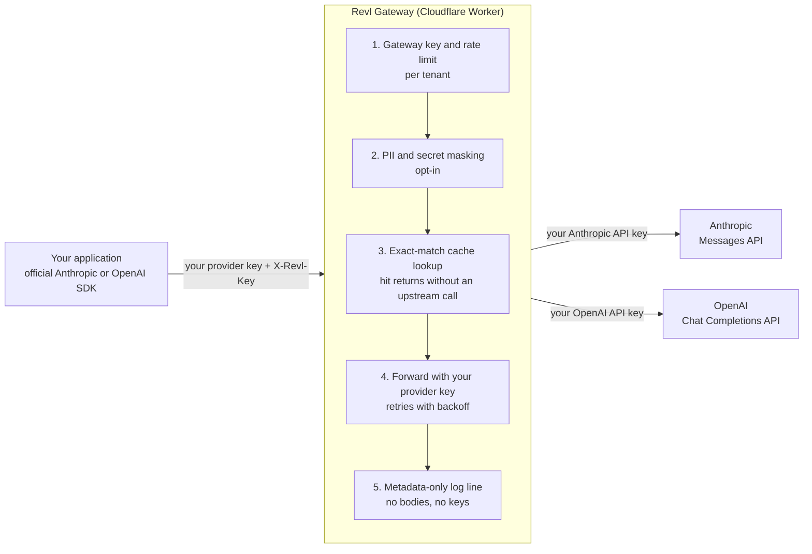

# Revl AI

[](https://github.com/trunghuynhnova/revl-ai-gateway/actions/workflows/test.yml)
[](LICENSE)


Revl AI is an open-source, bring-your-own-key (BYOK) AI gateway and reverse
proxy. It sits between your application and the Anthropic and OpenAI APIs and
adds response caching, rate limiting, PII and secret masking, retries and
metadata-only request logging. You keep using the official SDKs and your own
provider API keys.

**Status: v0.1, early.** The API may change. The hosted gateway at
`api.proxyrevlvay.com` is invite-only. Anyone can self-host the core today.

Website: https://proxyrevlvay.com · Docs: https://proxyrevlvay.com/docs · Contact: founder@proxyrevlvay.com

## Bring your own key

Revl AI does not resell, sublicense, pool or share model-provider API access.

- Every request is authenticated to Anthropic or OpenAI with **your own API
  key**, under your own provider account, billing and that provider's terms and
  usage policies.
- A provider key is forwarded for the single request it arrives with. It is
  never written to storage, cache or logs.
- Only provider API keys are accepted. OAuth and consumer subscription tokens
  are rejected.
- Revl is middleware. It charges only for the gateway, never for model usage.

## What it does

| Capability | v0.1 | Notes |
|---|---|---|
| Anthropic Messages API passthrough | Available | `POST /v1/messages`, native wire format |
| OpenAI Chat Completions passthrough | Available | `POST /v1/chat/completions`, native wire format |
| Gateway access keys | Available | Stored only as SHA-256 hashes |
| Exact-match response cache | Available | Opt-in per request, isolated per tenant and per provider key |
| PII and secret masking with rehydration | Available | Non-streaming requests, pattern based |
| Retries with backoff | Available | Opt-in, up to 3, on 429, 500, 502, 503 and 504 |
| Per-tenant rate limiting | Available | Workers rate limiting binding |
| Streaming passthrough | Available | Not cached, not masked |
| Semantic (embedding-based) caching | Roadmap | |
| Cross-provider fallback | Roadmap | |
| Usage dashboard and analytics API | Roadmap | |
| Per-key budgets, SSO and SCIM, custom detectors | Roadmap | |

The full contract is in [`gateway/SPEC.md`](gateway/SPEC.md).

## Architecture



The gateway holds no provider credentials. Two keys travel with each request:
your provider key in the provider's usual header, and a Revl key in
`X-Revl-Key` that only identifies you to the gateway and is never sent
upstream.

## Quickstart with the Anthropic SDK

```bash
pip install anthropic
export ANTHROPIC_API_KEY="..."   # your own Anthropic API key
export REVL_API_KEY="..."        # your gateway key
```

```python
import os
from anthropic import Anthropic

client = Anthropic(
    # The SDK appends /v1/messages. Self-hosting? Use your own Worker URL here.
    base_url="https://api.proxyrevlvay.com",
    api_key=os.environ["ANTHROPIC_API_KEY"],
    default_headers={
        "X-Revl-Key": os.environ["REVL_API_KEY"],
        "X-Revl-Cache": "exact",   # optional: cache identical requests
        "X-Revl-Mask": "pii",      # optional: mask emails, phones, cards, IPs
    },
)

message = client.messages.create(
    model="claude-opus-5-5",
    max_tokens=16000,
    messages=[{"role": "user", "content": "Hello"}],
)
for block in message.content:
    if block.type == "text":
        print(block.text)
```

The OpenAI SDK works the same way with `base_url="https://api.proxyrevlvay.com/v1"`.
More examples, including Node.js and cURL, are in
[`gateway/examples`](gateway/examples) and in the
[documentation](https://proxyrevlvay.com/docs).

## Configuration

### Per-request options

| Header | Values | Default | Effect |
|---|---|---|---|
| `X-Revl-Key` | `rvl_live_...` | required | Identifies you to the gateway |
| `X-Revl-Cache` | `exact`, `off` | `off` | Exact-match response cache |
| `X-Revl-Cache-TTL` | seconds | `3600` | Clamped to 60..86400 |
| `X-Revl-Mask` | `pii`, `secrets`, `off` | `off` | Mask matches before the request leaves the gateway |
| `X-Revl-Retries` | `0` to `3` | `0` | Retry upstream on 429, 500, 502, 503, 504 and network errors |

Every proxied response carries `X-Revl-Request-Id`, `X-Revl-Cache-Status`,
`X-Revl-Upstream-Ms`, `X-Revl-Masked` and `X-Revl-Retries`.

### Deployment settings

Set in [`gateway/wrangler.jsonc`](gateway/wrangler.jsonc):

| Setting | Purpose |
|---|---|
| KV namespace `KEYS` | Hashed gateway keys |
| KV namespace `CACHE` | Cached responses |
| Rate limit binding `RATE_LIMITER` | Requests per tenant per minute (default 60) |
| Variable `REQUIRE_GATEWAY_KEY` | `"true"` by default. `"false"` for single-tenant self-hosting |
| Variables `ANTHROPIC_BASE_URL`, `OPENAI_BASE_URL` | Optional upstream overrides |

## Self-hosting

```bash
git clone https://github.com/trunghuynhnova/revl-ai-gateway.git
cd revl-ai-gateway/gateway
npm install
npx wrangler kv namespace create KEYS
npx wrangler kv namespace create CACHE
# put the two namespace ids into wrangler.jsonc, then:
npx wrangler deploy
node scripts/create-key.mjs --id my-team --label "my first key"
```

`create-key.mjs` prints a new gateway key once, together with the command that
stores its hash. See [`gateway/README.md`](gateway/README.md) for details.

## Data handling

- Request and response bodies are never logged.
- One metadata line is logged per request: request id, tenant, route, model,
  status, cache status, upstream latency, masked count, retries, streaming flag.
- Cache entries exist only for requests that turn caching on, for the TTL the
  caller sets.
- Masking is pattern based. It will miss things and is not a compliance
  control by itself.

## Repository layout

| Path | Contents |
|---|---|
| `gateway/` | The open-source gateway core: source, tests, examples, specification |
| `revl-ai/` | The static website served at proxyrevlvay.com |
| `src/worker.js` | The website's Worker: waitlist endpoint, HTTPS redirect, security headers |
| `schema.sql` | The waitlist table |
| `tailwind.config.cjs`, `styles/` | Source for the site stylesheet at `revl-ai/assets/site.css` |

## Development

```bash
cd gateway
npm test
```

The tests use only `node:test` and need no network access or provider keys.

## Security

Please report vulnerabilities privately to founder@proxyrevlvay.com. See
[`gateway/SECURITY.md`](gateway/SECURITY.md).

## License

The code in this repository is released under the [MIT licence](LICENSE). The
Revl AI name and logo, and the website copy under `revl-ai/`, identify this
project and are not offered for reuse as another project's branding.

Revl AI is an independent project. It is not affiliated with, endorsed by or
sponsored by Anthropic or OpenAI. Claude is a trademark of Anthropic, PBC.
OpenAI and GPT are trademarks of OpenAI.
